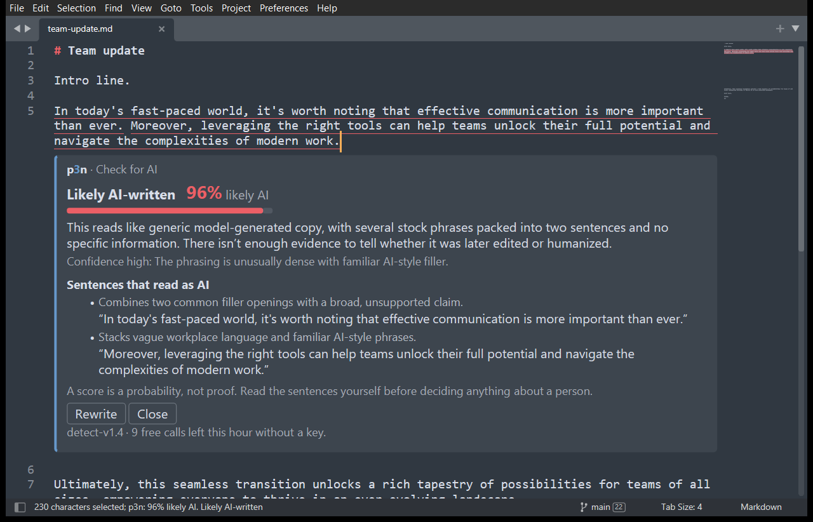
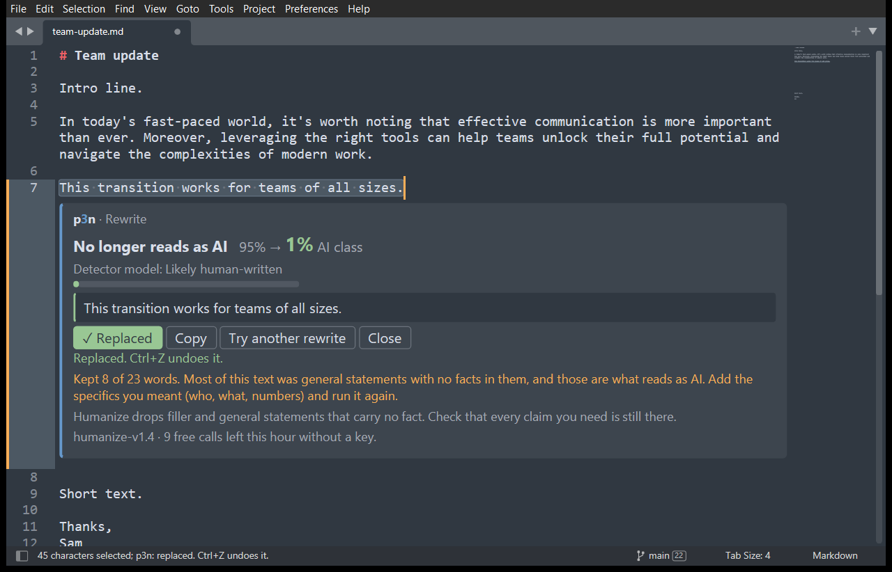
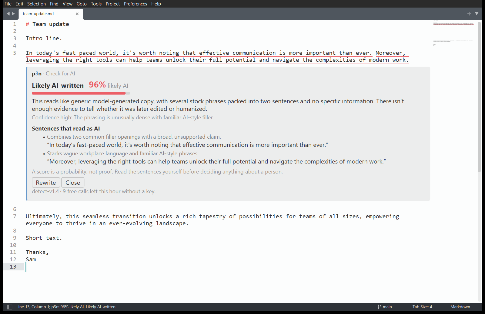

<p align="center">
  
</p>

<h1 align="center">p3n for Sublime Text</h1>

<p align="center">
  Select text in Sublime Text. See if it reads as AI-written, or rewrite it in place.
</p>

<p align="center">
  <a href="#install">Install with Package Control</a> · <a href="https://p3n.si">p3n.si</a> · <a href="https://nikita-andreiev.com/p3n/">All p3n apps</a>
</p>

<p align="center">
  <a href="https://github.com/Barabosik/p3n-sublime/actions/workflows/ci.yml"></a>
  <a href="https://github.com/Barabosik/p3n-sublime/releases/latest"></a>
</p>



## What it does

- **p3n: Check for AI.** A score, a one-line reason, and the sentences that give it away. Those sentences are underlined in your text, and clicking one in the card jumps to it.
- **p3n: Rewrite.** A version that keeps your facts and drops the filler. **Replace selection** puts it where your selection was, and Ctrl+Z (Cmd+Z on a Mac) undoes it in one step.
- Results open in a card under your selection. The card uses your colour scheme's colours, light or dark.



## Install

It needs Sublime Text 4 (build 4107 or later).

**With Package Control.** p3n isn't in Package Control's own list yet, so you add its address once:
1. Open the command palette (Ctrl+Shift+P, or Cmd+Shift+P on a Mac). Run **Package Control: Add Repository**, paste this address and press Enter:
   ```
   https://raw.githubusercontent.com/Barabosik/p3n-sublime/main/repository.json
   ```
2. Run **Package Control: Install Package** and choose **p3n**.

Package Control keeps p3n up to date from then on. If the palette has no Package Control commands, run **Install Package Control** first.

**By hand.** This way it doesn't update itself.
1. In Sublime Text, choose **Preferences › Browse Packages…**.
2. Put this repository there in a folder named exactly `p3n`. Either clone it with `git clone https://github.com/Barabosik/p3n-sublime.git p3n`, or download the ZIP and rename the folder.
3. Restart Sublime Text.

## Use it

Select some text, then right-click it or open the command palette (Ctrl+Shift+P, or Cmd+Shift+P on a Mac).

| Command | What it does |
| --- | --- |
| p3n: Check for AI | Checks the selection. With several selections, it checks them together. |
| p3n: Rewrite | Rewrites the selection. One selection at a time. |
| p3n: Cancel | Stops waiting for a result. Shown while p3n is working. |
| p3n: Clear Results | Closes the card and removes the underlines. |
| p3n: Set API Key | Checks a key with p3n, then saves it. |
| p3n: Remove API Key | Removes the saved key. |
| Preferences: p3n Settings | Opens the settings. |

The right-click menu shows the first two only when text is selected. p3n adds no key bindings. To add your own, open **Preferences › Key Bindings** and add, for example:

```json
{ "keys": ["ctrl+alt+shift+c"], "command": "p3n_check" },
{ "keys": ["ctrl+alt+shift+r"], "command": "p3n_rewrite" }
```

## Free, or with a key

You get 10 checks or rewrites an hour without an account, up to 5,000 characters each. For more, [sign up at p3n.si](https://p3n.si/register) (you get free credit), make a key on the [API keys](https://p3n.si/dashboard/keys) page, and run **p3n: Set API Key**. With a key, a call takes up to 200,000 characters and is billed to your p3n balance.

## When your text leaves your computer

p3n sends the text you selected to `api.p3n.si` over HTTPS. That happens only when you run p3n: Check for AI or p3n: Rewrite, or click Rewrite or Try another rewrite on a card. Nothing is sent when you open, edit or save a file. It sends no other text, keeps no history and has no analytics or telemetry. p3n: Set API Key sends the key alone, to check it.

Your API key is saved in `Packages/User/p3n.sublime-settings`, in plain text. If you sync or publish your Sublime settings, keep that file out, or set the `P3N_API_KEY` environment variable instead. The details, and what p3n does with the text, are in [PRIVACY.md](PRIVACY.md).

## Settings

| Setting | Default | What it does |
| --- | --- | --- |
| `api_key` | `""` | Your p3n API key. Empty means keyless use, with the free hourly limit. |
| `highlight_sentences` | `true` | Underline the sentences that read as AI, and dot-underline the pattern hits. |
| `show_reasons` | `false` | Also show each sentence's reason at the right edge of the view. |



## Other p3n apps

p3n also works in [Chrome and Firefox](https://nikita-andreiev.com/p3n/#browser), [Word and Excel](https://nikita-andreiev.com/p3n/#office), [Google Docs](https://nikita-andreiev.com/p3n/#docs), [VS Code](https://nikita-andreiev.com/p3n/#vscode) and [Obsidian](https://nikita-andreiev.com/p3n/#obsidian). Install steps for each are on [nikita-andreiev.com/p3n](https://nikita-andreiev.com/p3n/).

## Develop

Tests, the in-editor checks and the release steps are in [CONTRIBUTING.md](CONTRIBUTING.md).

## Licence

MIT
